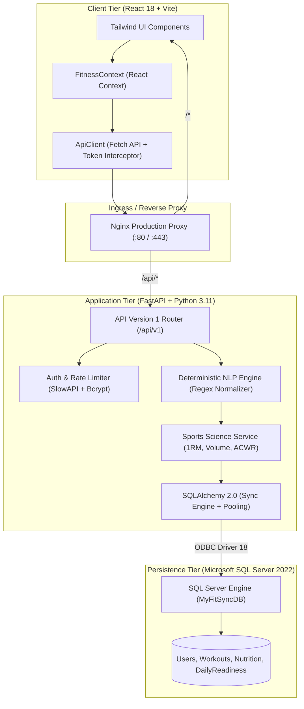
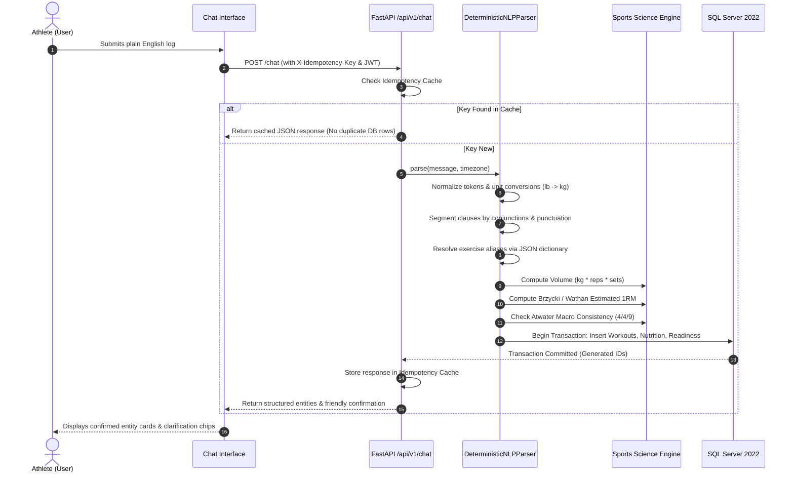
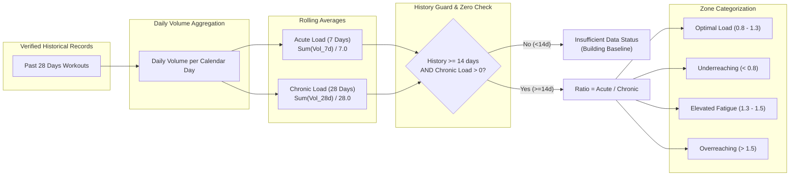
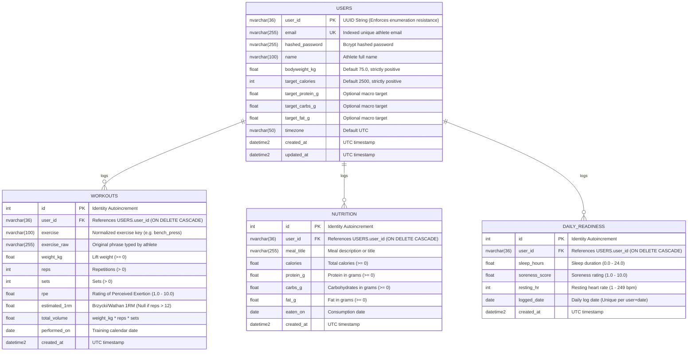

# MyFitSync System Architecture

This document describes the architectural foundation, component relationships, data flow sequences, and database design of **MyFitSync ("Your Personal Fitness Intelligence")**.

---

## 1. High-Level Architecture Overview

MyFitSync is an enterprise-grade fitness intelligence system built on a multi-tier, containerized architecture. It pairs a **deterministic, rule-based NLP pipeline** with **verified SQL Server persistence** and **peer-reviewed sports science formulations**.

---

## 2. Multi-Intent NLP Pipeline Sequence

When an athlete types natural language (e.g. `"Squats 100 kg 5 reps 3 sets at RPE 8, ate 2200 kcal with 160 g protein, slept 7 hours"`), the request is processed through a deterministic multi-stage pipeline:

---

## 3. Acute:Chronic Workload Ratio (ACWR) Calculation Flow

The ACWR engine quantifies training fatigue and load spikes by comparing 7-day acute volume to 28-day chronic volume using rolling daily averages:

> [!IMPORTANT]
> **Mandatory Clinical Disclaimer:** The Acute:Chronic Workload Ratio is an evidence-based training load monitoring metric, not a clinical diagnostic tool or medical predictor. It is presented with a non-dismissible guidance disclaimer across all views.

---

## 4. Database Schema & Entity-Relationship Diagram

MyFitSync enforces strict referential integrity, check constraints, nonclustered indexes, and `ON DELETE CASCADE` inside Microsoft SQL Server 2022:

---

## 5. Security & Multi-Tenant Data Isolation

MyFitSync implements defense-in-depth isolation across all operational layers:
1. **Enumeration Resistance:** All User IDs are random RFC 4122 v4 UUIDs (`String(36)`), eliminating sequential ID guessing attacks.
2. **Strict 404 on Foreign Resources:** Any attempt by an authenticated user to query, mutate, or delete a resource belonging to another user returns a strict **HTTP 404 Not Found** (never 403 Forbidden), preventing attackers from inferring the existence of other users' records.
3. **Database Check Constraints:** Data bounds (e.g. `reps > 0`, `weight_kg >= 0`, `sleep_hours BETWEEN 0 AND 24`) are enforced at both the Pydantic schema level and the database table level.
4. **Least Privilege Database Login:** The application connects exclusively as `myfitsync_app`, granted only `db_datareader` and `db_datawriter` on `MyFitSyncDB`—with zero permissions on `master` or server-level administrative privileges.
5. **Rate Limiting & Lockout:** SlowAPI protects endpoints from brute force, and an automatic failed-login tracker locks accounts for 15 minutes after 5 consecutive failures.
